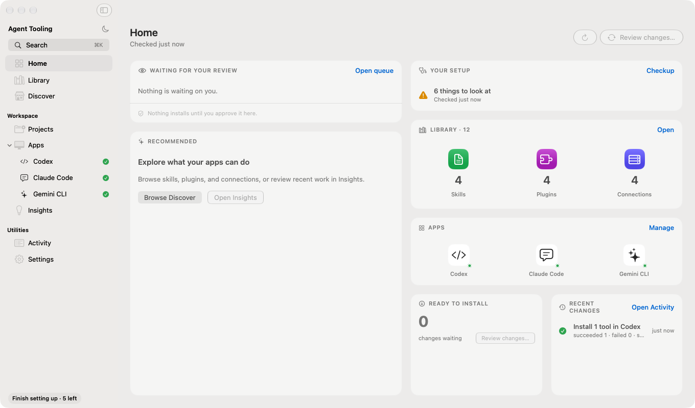
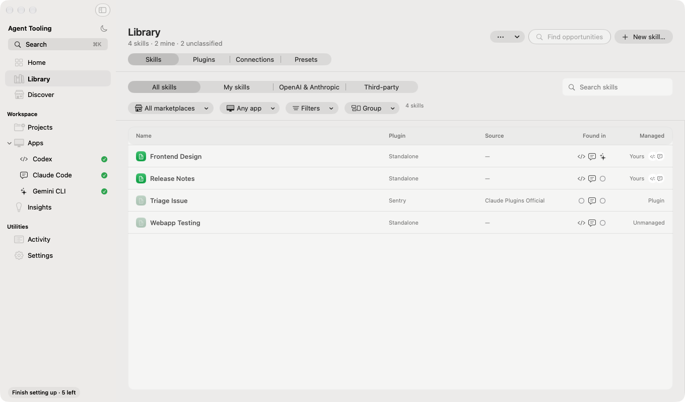
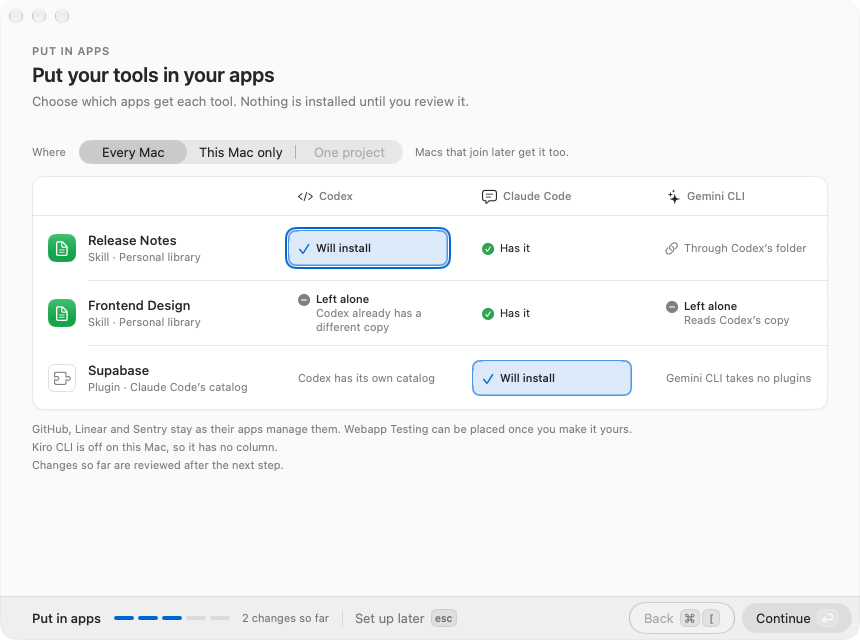

# Agent Tooling

A native macOS app for managing skills, plugins, and MCP connections across
**Codex, Claude Code, Gemini CLI, and Kiro CLI**.

Keep a local library, choose where tools are installed, and review changes to
your setup.

[App guide](apps/agent-tooling-macos/README.md) ·
[Releases](https://github.com/adalloul0928/agent-tooling/releases) ·
[Report an issue](https://github.com/adalloul0928/agent-tooling/issues)



## Install

**Requires macOS 26 or later and an Apple Silicon Mac.**

The first public DMG has not been published yet. [Build from source](#build-from-source)
to try the app today, or check [Releases](https://github.com/adalloul0928/agent-tooling/releases)
for a signed download.

Once a release is available, open `Agent-Tooling-arm64.dmg`, drag **Agent
Tooling** into **Applications**, eject the DMG, and open the app. To update,
quit Agent Tooling and replace it with the new version.

Install and sign in to your chosen clients separately. Supported operations
depend on each client's version; see [compatibility](docs/compatibility.md).

## What it does

- **Manage your library.** Browse tools, inspect their sources, and assign them
  to clients or projects. Native plugins stay together as packages.
- **Review installations and updates.** Check conflicts and changes to existing
  files, track repository updates, and keep receipts and backups of app changes.
- **Create skills and check your setup.** Edit skills locally, or use an
  installed Claude Code or Codex client to draft skills and inspect configuration.
- **Share a library across Macs.** Optionally sync through a Git repository you
  control. Each Mac reviews and applies its own installation changes.



## Set up your Mac

Guided setup lets you choose clients, review the locations Agent Tooling will
read, and build a library from what it finds. Then choose tools to install,
assistant permissions, and optional sync. You can resume setup from Home or
reopen it from **Agent Tooling → Set Up This Mac…**.



All screenshots show the app's actual SwiftUI views with synthetic sample data.

## Your data

Your library lives in `~/Library/Application Support/Agent Tooling/`. Local use
does not require a GitHub account or sync repository.

Credentials stay with their owning client, account, or keychain. Portable
workspace records contain credential references rather than secret values.

Discovery, update checks, optional sync, and assistant features contact the
services you choose. Assistant requests use your installed client and account.
See [privacy and feature limits](apps/agent-tooling-macos/README.md#assistants-accounts-and-privacy).

## Build from source

Install Xcode with the macOS 26 SDK and Swift 6.2 or later, then run:

```sh
git clone https://github.com/adalloul0928/agent-tooling.git
cd agent-tooling/apps/agent-tooling-macos
./scripts/package-app.sh
open '.build/Agent Tooling.app'
```

The script builds, packages, and checks the app. Local builds use ad hoc
signing. Public downloads use the signed and notarized
[release workflow](docs/macos-app-release.md).

To run the Swift tests from the same directory:

```sh
swift test --disable-sandbox --no-parallel
```

## Contribute

Report bugs and request features in [GitHub Issues](https://github.com/adalloul0928/agent-tooling/issues).
Include the app version, macOS version, and steps to reproduce. Remove account
details, secrets, and private paths from logs before sharing them.

- [App guide and development](apps/agent-tooling-macos/README.md#development)
- [Architecture and behavioral contracts](docs/README.md)
- [Release instructions](docs/macos-app-release.md)
- [Third-party components](docs/third-party-reuse-2026-09.md)

## License

Agent Tooling is [MIT licensed](LICENSE). Copyright © 2026 Agent Tooling contributors.

Third-party dependencies retain their own licenses and notices. The macOS app
includes its MIT license and [third-party notices](apps/agent-tooling-macos/Sources/AgentToolingApp/Resources/ThirdPartyNotices.txt).
